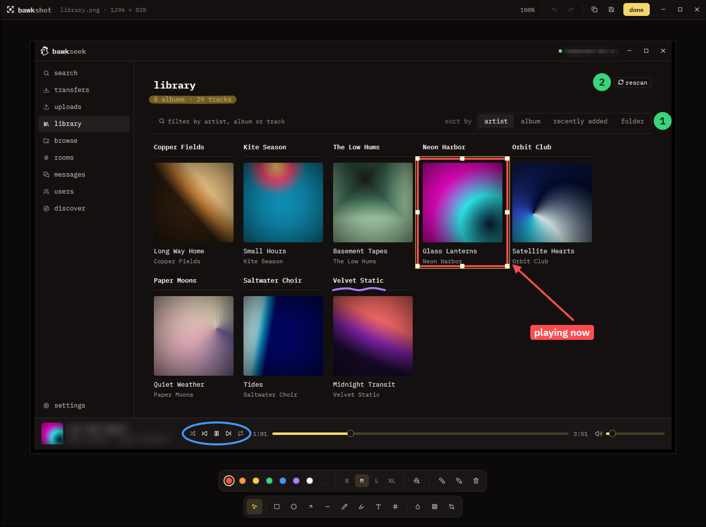
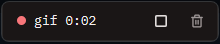
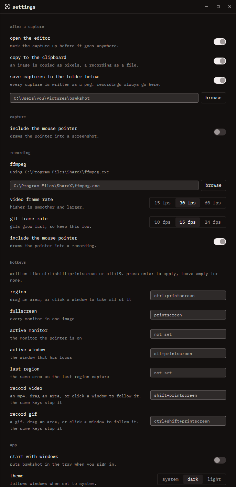

# bawkshot

[](#get-started)
[](LICENSE)

bawkshot is a Windows screenshot tool that lives in the tray. Press a hotkey, pick an area or a window, and mark the capture up before you paste or save it. It also records an area or a window to an MP4 or a GIF.



## Get started

### 1. Install

1. Open the [releases page](https://github.com/juddisjudd/bawkshot/releases) and download the newest `bawkshot-…-windows-x64-setup.exe`.
2. Run it. It installs for your user only, so it does not ask for an administrator.
3. Leave **Start bawkshot** ticked on the last page and click **Finish**.

You need Windows 10 or 11, 64-bit. bawkshot has no main window. Look for its icon in the tray.

**"Windows protected your PC"?** bawkshot is not signed with a paid certificate yet, so Windows may warn you the first time. Click **More info**, then **Run anyway**.

**No installer?** Download `bawkshot-…-windows-x64.zip` instead. Unzip it anywhere and double-click `bawkshot.exe`.

**To remove it,** open Windows Settings → Apps → Installed apps, find bawkshot and choose **Uninstall**. Your settings and captures stay.

### 2. Take a screenshot

Press **Ctrl+PrtSc**, or left-click the tray icon. The screen freezes. Drag an area, or click a window to take all of it. Press **Esc** or right-click to cancel.

Right-click the tray icon for the other capture modes.

### 3. Mark it up

The capture opens in the editor. Pick a tool from the bar at the bottom and draw. Press **Enter**, or click **done**, when you are finished. That copies the image, saves it and closes the editor.

Captures go to a `bawkshot` folder inside your Pictures folder. You can change the folder under **settings**.

### 4. Record a video or a GIF

Recording needs [ffmpeg](https://ffmpeg.org). bawkshot finds it by itself when it is on your `PATH`. One way to install it is `winget install ffmpeg`.

Press **Shift+PrtSc** for a video, or **Ctrl+Shift+PrtSc** for a GIF. Then:

- Drag an area to record that part of the screen.
- Click a window to record it and follow it when it moves.

A yellow outline and a small control show what is being recorded. Neither appears in the recording. To stop, press the same keys again, click the square on the control, or left-click the tray icon. The bin on the control throws the recording away.



### 5. Start with Windows

Right-click the tray icon, open **settings**, and turn on **start with windows**. The installer can do the same: tick **Start bawkshot when I sign in to Windows**.

### 6. Stay up to date

bawkshot looks for a new version on GitHub when it starts, and once a day after that. When one is out, you get a notification, and the tray menu shows **settings · update available**.

1. Open **settings** and scroll to **about**.
2. Press **update**.
3. Press **restart now**. A recording in progress is saved first.

Your settings stay as they are. To stop the checks, turn off **check for updates** in the same place.

## Everything it does

- **Capture modes:** a region, every monitor in one image, the monitor under the pointer, the window that has focus, and the last region again.
- **Window snap:** during a region capture, click a window instead of dragging to take exactly that window.
- **Editor tools:** select, rectangle, ellipse, arrow, line, pen, highlighter, text, step numbers, blur, pixelate and crop.
- **Editing:** move and resize what you drew, select several with a drag, duplicate, bring to front or send to back, undo and redo. Zoom with the wheel and pan with space and drag.
- **Styles:** eight colors and four sizes. Rectangles and ellipses can be filled. Text can sit on a colored label.
- **Recording:** MP4 (H.264) or GIF, at 15, 30 or 60 frames per second for video and 10, 15 or 24 for GIF. The mouse pointer is drawn in unless you turn it off.
- **After a capture:** open the editor, copy to the clipboard, save a PNG. Each one is a switch in settings. A finished recording is copied as a file, so it pastes into a chat or a folder.
- **Hotkeys** for every capture mode and for both kinds of recording. Change them in settings.
- **Open an image** from disk or from the clipboard to mark it up.
- **Updates** itself from the releases page. Each download is checked against its SHA-256 checksum before it is installed.
- **Themes:** dark, light, or follow Windows.
- **Command line** to capture or record from a script.

## A closer look

**Settings** holds the after-capture steps, the recording options, every hotkey and the startup switch.



## Keys

These are the starting hotkeys. They work from any app while bawkshot runs.

| Press | To |
| --- | --- |
| `Ctrl+PrtSc` | capture a region or a window |
| `PrtSc` | capture every monitor |
| `Alt+PrtSc` | capture the window that has focus |
| `Shift+PrtSc` | start or stop a video recording |
| `Ctrl+Shift+PrtSc` | start or stop a GIF recording |

The active monitor and last region modes have no hotkey until you set one.

In the editor:

| Press | To |
| --- | --- |
| `V` `R` `O` `A` `L` | select, rectangle, ellipse, arrow, line |
| `P` `H` `T` `N` | pen, highlighter, text, step number |
| `B` `X` `C` | blur, pixelate, crop |
| `Shift` while drawing | keep a square, or snap a line to 45 degrees |
| `Ctrl+Z`, `Ctrl+Shift+Z` | undo, redo |
| `Ctrl+D`, `Del` | duplicate, delete |
| `[`, `]` | send to back, bring to front |
| arrow keys | nudge the selection, 10 pixels with `Shift` |
| `Ctrl+0`, `Ctrl+1` | fit the image, show it at 100% |
| `Ctrl+C`, `Ctrl+S`, `Ctrl+Shift+S` | copy, save, save as |
| `Enter` | copy, save and close |

## Command line

Arguments are read when bawkshot starts. They do nothing if it is already running.

| Run | To |
| --- | --- |
| `bawkshot shot.png` | open an image in the editor |
| `bawkshot --capture region` | take a capture at once. Also `fullscreen`, `active-monitor`, `active-window`, `last-region` |
| `bawkshot --record gif` | pick what to record. Also `video` |
| `bawkshot --record video --area 100,100,1280,720` | record that area: left, top, width, height in screen pixels |
| `bawkshot --record gif --window active --seconds 5` | follow the window that has focus and stop after 5 seconds |
| `bawkshot --settings` | open settings |

## When something doesn't work

**"Some hotkeys are not active".** Another program, often another screenshot tool, already holds those keys. Close it or change its keys, or pick other keys under **settings**. The hotkeys that failed are marked there.

**PrtSc opens the Windows Snipping Tool.** Windows can keep that key for itself. Turn off **Use the Print screen key to open screen capture** under Windows Settings → Accessibility → Keyboard.

**"ffmpeg was not found".** Install ffmpeg, or point bawkshot at `ffmpeg.exe` under **settings → recording**. bawkshot looks next to its own exe, in its settings folder, on your `PATH`, and in ShareX's folders.

**A recording is not as smooth as the frame rate I chose.** Copying a large area of the screen takes time, so a big recording may not reach 60 frames per second. The video still plays at the right speed.

**I resized the window I am recording.** The recording follows where the window is, not how big it is. It keeps the size the window had when you started.

**Another window shows up in my window recording.** bawkshot records what is on screen where the window is. That includes the window's own menus and dialogs, and also anything you drag on top of it.

**Starting bawkshot again does nothing.** Only one copy runs at a time. Use the tray icon of the one that is running.

**An update fails with "cannot write next to bawkshot.exe".** bawkshot is in a folder it can't change, such as `Program Files`. Move it somewhere of your own, such as `Documents`, or run the new installer.

bawkshot has only been tried on displays at 100% scale.

## Where your things are

| What | Where |
| --- | --- |
| The program, when you used the installer | `%LOCALAPPDATA%\Programs\bawkshot` |
| Captures and recordings (change it under settings) | `Pictures\bawkshot` |
| Settings and hotkeys | `%APPDATA%\bawkshot\config.json` |
| What ffmpeg said about the last recording | `%APPDATA%\bawkshot\ffmpeg.log` |
| The startup entry | `HKCU\Software\Microsoft\Windows\CurrentVersion\Run`, value `bawkshot` |

To start fresh, quit bawkshot and delete the `%APPDATA%\bawkshot` folder.

## For developers

bawkshot is written in Rust with [GPUI Kit](https://gpui-kit.com). Capture, the tray, hotkeys and the startup entry go straight to Win32. Recording pipes raw frames to ffmpeg.

To build it you need Rust 1.92 or later with the MSVC toolchain, and Visual Studio 2022 Build Tools with the **Desktop development with C++** workload.

```sh
cargo run --release       # build and start
cargo test                # run the tests
```

The first build compiles GPUI and takes a few minutes. The tests drive the overlay, the editor and the recording control in headless windows. The recorder tests run a real ffmpeg on a test pattern, and pass without doing anything when ffmpeg is not installed.

To see errors, set two environment variables before you start it. In PowerShell:

```powershell
$env:LOG_LEVEL = "DEBUG"; $env:LOG_FILE = "$env:TEMP\bawkshot.log"; cargo run
```

Set `BAWKSHOT_HOME` to a folder to keep a second copy's settings apart from your own.

A copy run from `target` does not update itself; use git and cargo. To try the updater without publishing a release, copy a debug build out of `target` and set `BAWKSHOT_UPDATE_API` to an address that answers like GitHub's `releases/latest`. Release builds ignore that variable.

The icon files in `assets/brand` are drawn from `icon.svg`. After you change it, run `cargo run --example brand`.

### Make a release

The version lives in `Cargo.toml`. To publish a new one, run this from a clean `main`:

```powershell
.\scripts\release.ps1 -Version 0.2.0
```

It sets the version, commits, tags `v0.2.0` and pushes. The [release workflow](.github/workflows/release.yml) then tests and builds on Windows. It publishes the installer and a zip on the releases page, each with its SHA-256 checksum, with notes that GitHub generates. A tag that doesn't match the version in `Cargo.toml` fails the build.

Copies that are already installed find the release by themselves. The updater downloads the zip, checks it, and swaps `bawkshot.exe` in place, so keep the zip and its `.sha256` file in every release.

To try the workflow without publishing, start it by hand with `gh workflow run release.yml`. It builds the same files and keeps them on the run for 7 days.

The installer comes from [`packaging/windows/bawkshot.iss`](packaging/windows/bawkshot.iss), an [Inno Setup](https://jrsoftware.org/isinfo.php) script. To build the installer and the zip on your own PC, install Inno Setup 6, then run:

```powershell
cargo build --release
.\packaging\windows\package.ps1
```

Both files land in `dist`.

## Credits

- [GPUI Kit](https://github.com/longbridge/gpui-kit) (Apache-2.0) and Zed's GPUI draw the interface.
- [tray-icon](https://github.com/tauri-apps/tray-icon) and [global-hotkey](https://github.com/tauri-apps/global-hotkey) (MIT or Apache-2.0) run the tray menu and the hotkeys.
- [resvg](https://github.com/linebender/resvg) (MIT or Apache-2.0) draws the markup into the saved image. [arboard](https://github.com/1Password/arboard) (MIT or Apache-2.0) fills the clipboard.
- [FFmpeg](https://ffmpeg.org) encodes the recordings. It is not bundled.
- [IBM Plex](https://github.com/IBM/plex) Mono and Sans (SIL Open Font License, `assets/fonts/OFL.txt`) are the typefaces.
- [Lucide](https://lucide.dev) (ISC) icons.
- [Inno Setup](https://jrsoftware.org/isinfo.php) builds the installer.
- The capture modes take after [ShareX](https://github.com/ShareX/ShareX). The editor takes after the art mode in [scalpel](https://github.com/scalpelpoe/scalpel).

## License

[MIT](LICENSE).
